# Гийхнаран — хувийн портфолио

СЭЗИС, Мэдээллийн системийн 3-р курсын оюутан **Баттулга Гийхнаран**-ы SWM231 «Бүтээлч ажил».

Утсан дээр өөрийгөө, ур чадвараа, бүтээлээ танилцуулах жижиг апп. React Native (Expo), TypeScript, Expo Router ашиглан гараар бичсэн. No-code хэрэгсэл, худалдаж авсан загвар ашиглаагүй.

Код: https://github.com/giikhnaranbattulga7-ship-i/portfolio-app

Хар, цагаан, ногоон өнгө. Доод цэс: **Танилцуулга**, **Миний тухай**, **Бүтээлүүд**, **Холбоо барих**.

## Апп ажиллуулах

Android APK (урьдчилан бүтээсэн):

https://expo.dev/artifacts/eas/x4UKcSSeozMbZgU12svvctf8SlCdhNuzGrI6cK315b4.apk

`eas build -p android --profile preview` командаар бүтээсэн. Түгээлт нь `internal`. Утас үл мэдэгдэх эх сурвалжаас суулгахыг (unknown sources) зөвшөөрөхийг асууж болно.

Expo төслийн хуудас: https://expo.dev/accounts/giikhnaran/projects/giikhnaran-portfolio

Вэб демо: https://portfolio-giikhnaran.vercel.app

## Заавал байх 5 хэсэг

| Хэсэг | Хаана | Юу хийдэг вэ |
| --- | --- | --- |
| Танилцуулга | `src/app/(tabs)/index.tsx` | Эхний дэлгэцэд нэр, чиглэл, нэг өгүүлбэр. Stories маягаар товшиж үргэлжилнэ. |
| Миний тухай | `src/app/(tabs)/about.tsx` | Товч намтар, ур чадвар. |
| Бүтээлүүд | `src/app/(tabs)/works.tsx`, `src/components/WorkPager.tsx` | 3 бүтээл: зураг, тайлбар, холбоос. Хуруугаар шургуулна. |
| Холбоо барих | `src/app/(tabs)/contact.tsx`, `src/lib/openLink.ts` | Имэйл, GitHub товч шууд нээгдэнэ. |
| Дэлгэц ба суулгалт | `src/theme/useLayout.ts`, `eas.json` | Өргөнөөс зай, үсгийн хэмжээ өөрчлөгдөнө. Expo Go эсвэл APK. |

Хувийн мэдээлэл бүгд нэг файлд: `src/data/profile.ts`.

Утасны дугаар зориуд байхгүй. Нийтлэхэд эвгүй мэдээллээ оруулаагүй. `social.url` хоосон бол сошиал товч харагдахгүй. Холбоос нэмэх бол зөвхөн тэр файлыг засна.

## Бүтээлч санаа

1. **Stories.** Дээд талд явцын зураас. Баруун тал дараагийнх, зүүн тал өмнөх. Удаан дарвал түр зогсоно.
2. **Swipe карт.** Бүтээлээ зүүн, баруун тийш шургуулна. `react-native-reanimated` картаа зөөнө. «Өмнөх / Дараах» товч бас бий.
3. **Haptic.** Товч дарахад утас чичиргэнэ. Вэб дээр чичиргээ алгасна.
4. **Сэгсрэх нууц.** Утсаа сэгсрэхэд жижиг карт гарна. Вэб, эмулятор дээр логоны **Г** дээр удаан дарна.
5. **Хар / цагаан горим.** Баруун дээд товч.
6. **Өөрийн icon, splash.** Ногоон **Г** монограмм, хар дэвсгэр.

## Ашигласан сан

| Сан | Юунд хэрэгтэй |
| --- | --- |
| expo, expo-router | Апп, доод цэс, файл дээр суурилсан чиглүүлэг |
| react-native-reanimated | Картын гүйдэлт |
| react-native-gesture-handler | Хурууны шургуулга |
| react-native-safe-area-context | Утасны ирмэг, ховил |
| expo-haptics | Товчны чичиргээ |
| expo-sensors | Сэгсрэлт (Accelerometer) |
| expo-image | Бүтээлийн зургийг дээрээс нь харуулах |
| expo-font | Icon болон үсгийн фонт. Android APK-д фонт орно |
| expo-linking / Linking | Имэйл, GitHub нээх |
| expo-splash-screen | Эхлэх дэлгэц |
| @expo/vector-icons | Доод цэсний дүрс (Ionicons) |
| react-native-web, react-dom | Вэб экспорт |

## Ажиллуулах

```bash
npm install
npx expo start
```

Гарч ирсэн QR-ыг **Expo Go** аппаар уншуулна. Энэ төсөл **Expo SDK 58**. Expo Go хувилбар таарахгүй бол апп нээгдэхгүй. Тэр үед Expo Go-оо шинэчилнэ.

Вэб дээр шууд харах:

```bash
npx expo start --web
```

Төрөл шалгах:

```bash
npx tsc --noEmit
```

## Вэб экспорт ба Vercel

```bash
npx expo export -p web
```

Гаралт `dist/` хавтаст байна. `vercel.json` нь энэ командыг build болгож, `dist`-ийг гаргана. Цэвэр хаяг (`/about`, `/works`, `/contact`) HTML файл руу заагдана.

## Expo холбоос ба APK

Байнгын Expo Go холбоос гаргахын тулд өөрийн Expo бүртгэлээр:

```bash
npx expo start --tunnel
```

QR болон холбоос терминал дээр гарна. Энэ репозиторт бэлэн туннель холбоос байхгүй. Тэр нь таны Expo нэвтрэлт шаарддаг.

Бэлэн Android APK-г «Апп ажиллуулах» хэсгийн холбоосоор татна. Дахин бүтээх бол:

```bash
npm install -g eas-cli
eas login
eas build -p android --profile preview
```

`eas.json` дотор `preview` профайл `buildType: apk`, `distribution: internal`. Дууссан APK-г Expo-ийн хуудаснаас татаж утсандаа суулгана.

## Эх сурвалж

- Код бүгд энэ репозиторт гараар бичигдсэн.
- **Z Money**, **StudyMate AI** зураг нь өөрийн deploy хийсэн аппын дэлгэцийн зураг.
  - https://z-money-giikhnaran.vercel.app
  - https://studymate-ai-giikhnaran.vercel.app
  - Код: https://github.com/giikhnaranbattulga7-ship-i/finance-app-supabase
- **ShopMn** бол анхны Expo дасгал. Тусдаа нийтийн репозитор байхгүй тул холбоос нь GitHub профайл. Зураг нь өөрөө зурсан жишээ, бусдын зураг биш.
- App icon, splash, ShopMn зургийг Pillow-оор зурсан. Үсэгт **Inter** фонт (SIL Open Font License, Rasmus Andersson) ашигласан. Фонт файлыг апп ажиллахад татаж оруулаагүй. Зөвхөн зураг бүтээхэд хэрэглэсэн.
- Ionicons дүрсийг `@expo/vector-icons` өгдөг.
- Expo болон дээрх сангууд нь өөрсдийн лицензтэй (ихэнх нь MIT).

## Дэлгэцийн зураг

Танилцуулга:

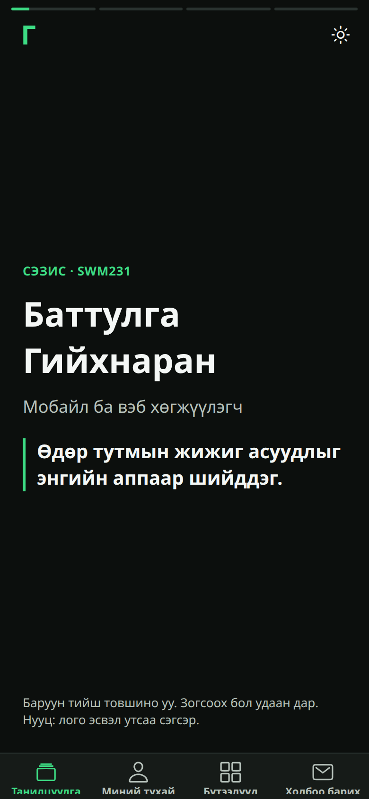

Дараагийн story:

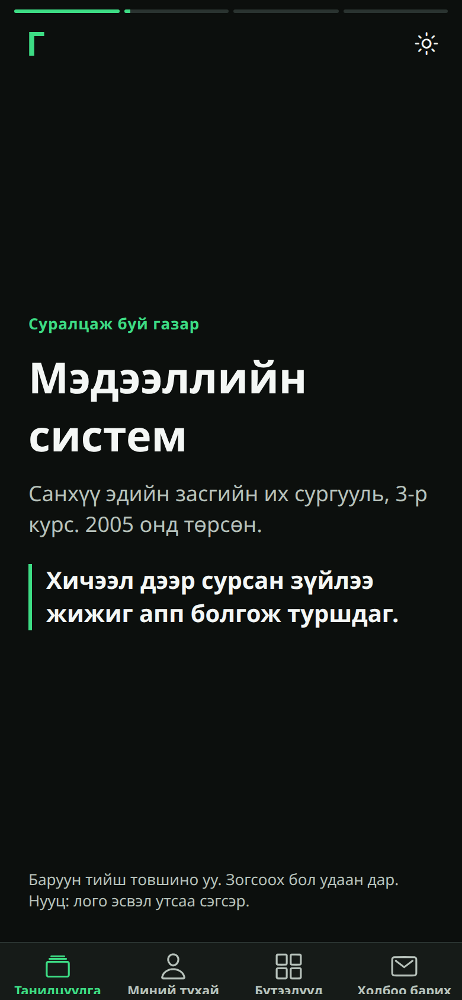

Миний тухай:

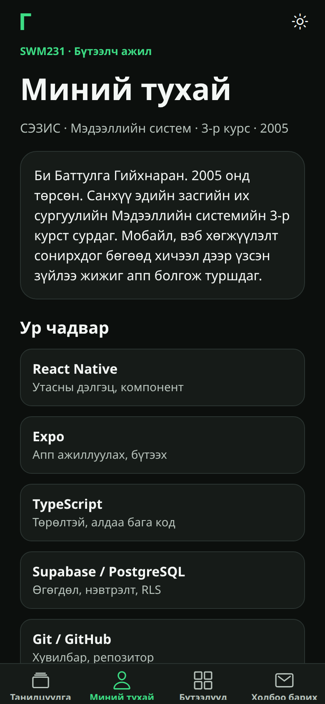

Бүтээлүүд:

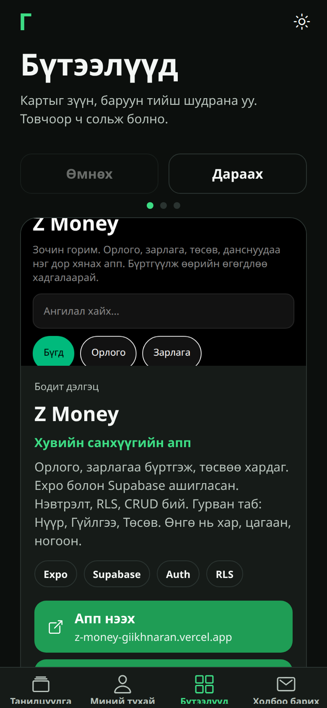

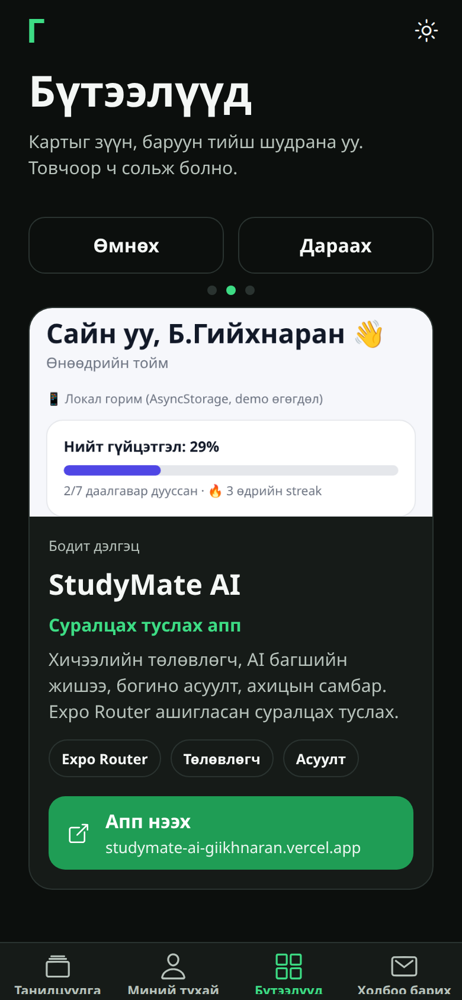

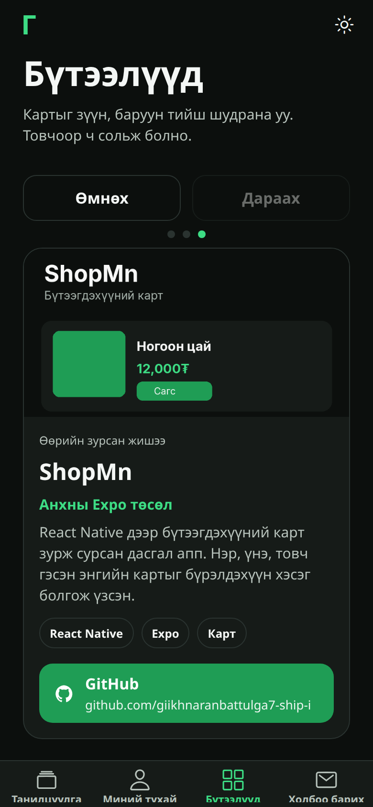

Холбоо барих, цагаан горим, нууц:

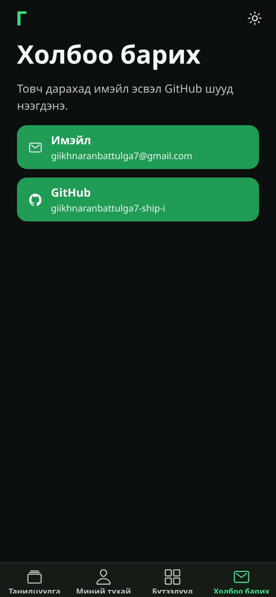

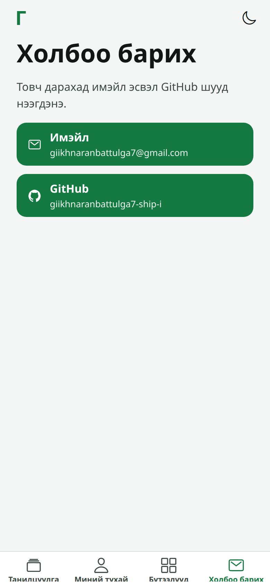

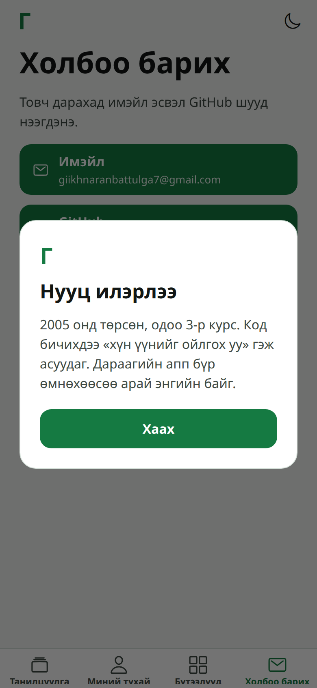

Нарийн (320) ба өргөн (430) утас:

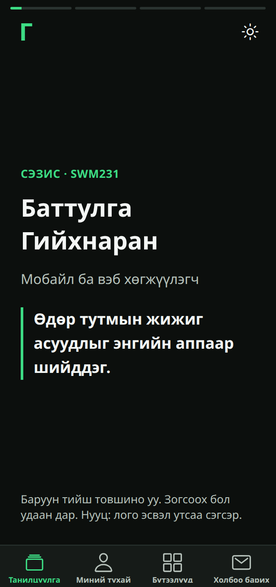

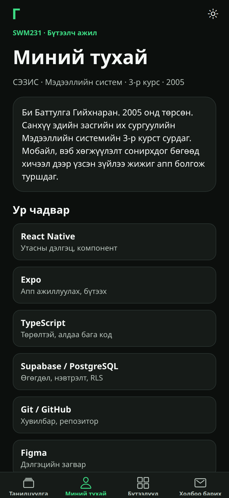

## Хязгаарлалт

- Вэб дээр чичиргээ, сэгсрэх мэдрэгч ажиллахгүй. **Г** дээр удаан дарна.
- Бэлэн APK «Апп ажиллуулах» хэсэгт байна. Байнгын Expo туннель холбоос энд байхгүй. Туннель өөрийн бүртгэлээр гаргана.
